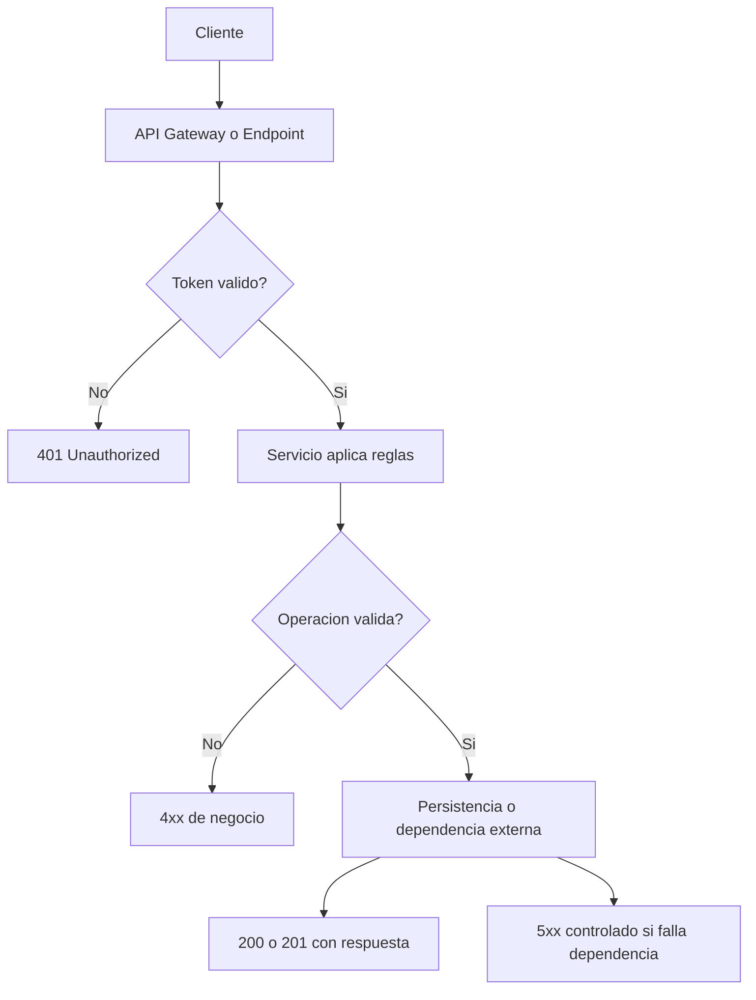
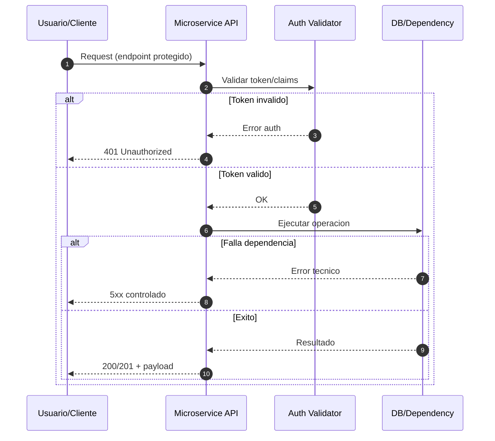

# Skill: API Microservice Documenter

## 1) Metadata
- Skill ID: api-microservice-documenter
- Version: 1.0.0
- Purpose: generar documentacion tecnica completa para entender que hace un microservicio, como se consume y como se opera.
- Audience (roles): Backend, Frontend, QA, Tech Lead, SRE, Security
- When to use: onboarding tecnico, handover entre equipos, readiness de PR, auditoria de cambios, preparacion de incident response.
- When NOT to use: cambios triviales sin impacto funcional (ej. typo), o cuando no hay artefactos tecnicos suficientes para documentar con evidencia.
- Sensitive inputs: nunca incluir secretos, tokens reales, datos personales ni informacion interna no autorizada.
- Expected output: un documento Markdown estructurado usando exactamente la seccion Output.

## 2) Inputs
Proporciona esta informacion para generar una documentacion precisa.

- Service name:
- Repository path:
- Main runtime and framework: (ej. Java Quarkus, Python FastAPI, Node Nest)
- API exposure: (REST, GraphQL, eventos)
- Entry points: (main class, app bootstrap, routes file)
- Endpoint sources: (controladores, routers, resources)
- Data sources: (DB, files, colas, servicios externos)
- Auth/Authz model:
- Config and env vars:
- Current tests and evidence available:
- Scope of documentation: (full service o solo modulos)
- Known constraints and assumptions:

Si falta informacion, el skill debe listarla en Preguntas abiertas y no inventar.

## 3) Output
Devuelve solo Markdown con estas secciones en este orden.

1. Summary ejecutivo
2. Proposito y responsabilidades del microservicio
3. Limites de alcance
   - Dentro del alcance
   - Fuera del alcance
4. Arquitectura interna
   - Componentes principales
   - Dependencias internas/externas
5. Contratos de API
   - Tabla de endpoints: metodo, ruta, auth requerida, request, response, codigos esperados
   - Reglas de validacion y errores
6. Seguridad
   - Mecanismo de autenticacion/autorizacion
   - Manejo de secretos y configuracion sensible
   - Superficies de riesgo
7. Datos y persistencia
   - Entidades principales
   - Flujos de lectura/escritura
   - Consideraciones de consistencia
8. Observabilidad y operacion
   - Health checks
   - Logging relevante
   - Alertas o metricas clave
9. Estrategia de pruebas
   - Unitarias
   - Integracion
   - Contrato
   - Casos negativos y seguridad
10. Riesgos, trade-offs y deuda tecnica
11. Runbook minimo
   - Como levantar local
   - Como validar rapido
   - Como rollback de un cambio
12. Diagrama de flujo (Mermaid)
13. Diagrama de secuencia (Mermaid)
14. Evidencia y referencias
15. Preguntas abiertas

## 4) Diagram Requirements (Obligatorio)
Incluye ambos diagramas con Mermaid valido.

### 4.1 Diagrama de flujo
Debe mostrar:
- entrada del cliente
- validacion auth
- decision principal
- acceso a datos/dependencias
- salida exitosa y salidas de error

Plantilla sugerida:

### 4.2 Diagrama de secuencia
Debe mostrar al menos:
- Actor cliente
- API del microservicio
- modulo auth o verificacion
- capa de datos o servicio externo
- respuesta final con codigo

Plantilla sugerida:

## 5) Constraints
- No inventar endpoints, codigos, payloads o dependencias no verificadas.
- Todo hallazgo debe estar respaldado por evidencia de codigo o pruebas disponibles.
- Si algo no se puede confirmar, marcarlo en Preguntas abiertas.
- No incluir secretos ni valores reales de credenciales.
- No afirmar CI, cobertura o escaneos si no hay evidencia explicita.
- Mantener foco en claridad operativa para que un nuevo integrante entienda el servicio rapidamente.

## 6) Validation Rules
La salida es valida si:
- Contiene las 15 secciones del Output en el orden indicado.
- Incluye ambos diagramas Mermaid (flujo y secuencia).
- Tiene tabla de endpoints con auth y codigos por endpoint.
- Declara al menos 3 riesgos o trade-offs concretos (o justifica por que no aplica).
- Incluye runbook minimo ejecutable en laboratorio.
- Distingue claramente hechos confirmados vs preguntas abiertas.

## 7) Evidence Package (recomendado)
Adjuntar o referenciar en el PR:
- SKILL.md versionado.
- Ejemplo de input en examples/input.sample.md.
- Ejemplo de output en examples/output.sample.md.
- Tag de version, por ejemplo: skill-api-doc-v1.0.0.
