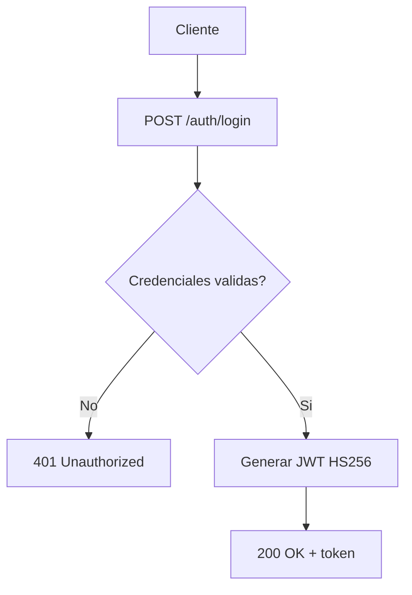
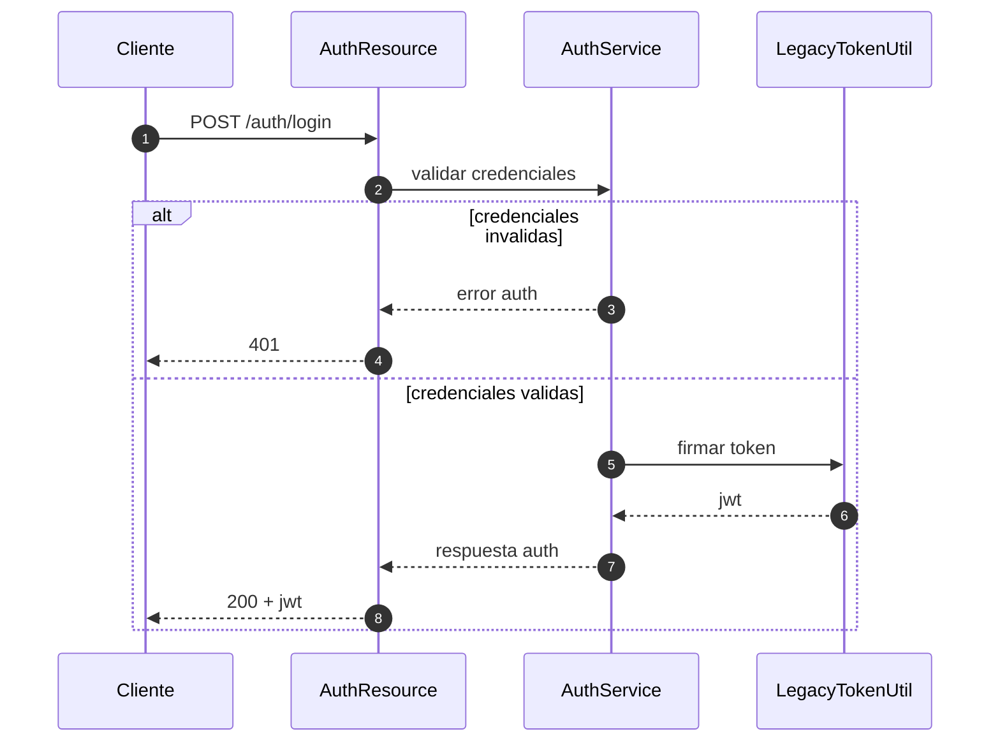

# Summary ejecutivo
Servicio de autenticacion del laboratorio que valida credenciales de entrada y emite token JWT para consumo de APIs internas.

# Proposito y responsabilidades del microservicio
- Centralizar login de usuarios del workshop.
- Emitir token firmado para autorizacion downstream.
- Exponer estado de salud para operacion basica.

# Limites de alcance
- Dentro del alcance:
  - Login y emision de token.
  - Validaciones basicas de credenciales.
- Fuera del alcance:
  - Gestion de perfiles compleja.
  - Federacion con proveedores externos.

# Arquitectura interna
- Componentes principales:
  - AuthResource: expone endpoints HTTP.
  - AuthService: orquesta validacion y emision.
  - LegacyTokenUtil: firma JWT.
- Dependencias internas/externas:
  - Configuracion de secretos por entorno.
  - Consumidores: frontend y requirements-api.

# Contratos de API
| Metodo | Ruta | Auth requerida | Request | Response | Codigos esperados |
|---|---|---|---|---|---|
| POST | /auth/login | No | username, password | token, role, user | 200, 401 |
| GET | /q/health | No | N/A | estado de salud | 200 |

- Reglas de validacion y errores:
  - Credenciales invalidas retornan 401 sin detalles sensibles.
  - Errores internos retornan 5xx controlado.

# Seguridad
- Mecanismo de autenticacion/autorizacion:
  - JWT HS256 emitido por backend de auth.
- Manejo de secretos y configuracion sensible:
  - Secretos via variables de entorno.
- Superficies de riesgo:
  - Reuso de token vencido.
  - Exposicion de mensajes de error demasiado detallados.

# Datos y persistencia
- Entidades principales:
  - Usuario autenticado (username, role).
- Flujos de lectura/escritura:
  - Lectura de fuente legacy para validacion.
- Consideraciones de consistencia:
  - Respuesta de token consistente para servicios consumidores.

# Observabilidad y operacion
- Health checks:
  - /q/health disponible.
- Logging relevante:
  - Eventos de login exitoso/fallido sin secretos.
- Alertas o metricas clave:
  - Tasa de 401.
  - Latencia del endpoint de login.

# Estrategia de pruebas
- Unitarias:
  - Validacion de credenciales y claims.
- Integracion:
  - Flujo login end-to-end local.
- Contrato:
  - Compatibilidad de claims con requirements-api.
- Casos negativos y seguridad:
  - Token invalido, expirado, issuer incorrecto.

# Riesgos, trade-offs y deuda tecnica
- Riesgo de drift de contrato JWT entre servicios.
- Trade-off: simplicidad HS256 en laboratorio vs robustez de gestion de llaves.
- Deuda: ampliar pruebas de resiliencia y observabilidad.

# Runbook minimo
- Como levantar local:
  - Compilar y ejecutar con perfil local.
- Como validar rapido:
  - Probar /auth/login y /q/health.
- Como rollback de un cambio:
  - Revertir commit del cambio de contrato y redeploy local.

# Diagrama de flujo (Mermaid)

# Diagrama de secuencia (Mermaid)

# Evidencia y referencias
- Referenciar rutas de codigo, pruebas ejecutadas y reportes disponibles.
- Indicar explicitamente lo no verificado.

# Preguntas abiertas
- Existe politica formal de rotacion de secretos para laboratorio?
- Se requiere estandar de codigos de error compartido entre microservicios?
